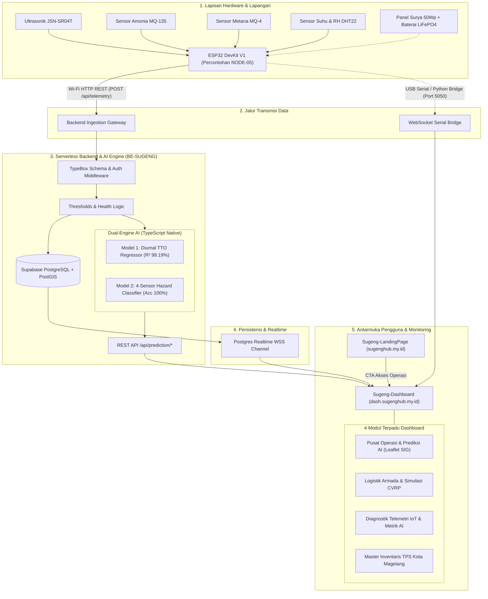
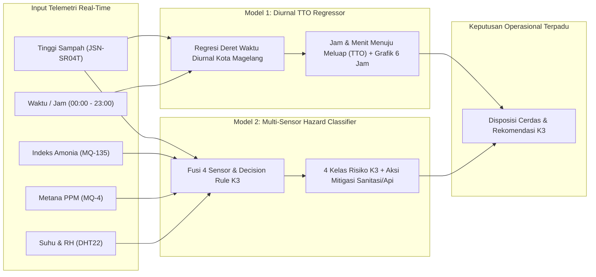

# 🌿 DOKUMENTASI LENGKAP PROYEK SUGENG
> **Sistem Unggulan Pengelolaan & Monitoring Sampah Berbasis IoT & Dual-Engine AI**  
> **Studi Kasus:** Dinas Lingkungan Hidup (DLH) Kota Magelang & TPSA Banyuurip, Jawa Tengah  
> **Versi Dokumentasi:** 1.2.0 (Terbaru - November 2026)  
> **Status Proyek:** Siap Sidang / Production Ready (Backend, Dashboard Web, Landing Page, & Dual-AI)

---

## 1. Ringkasan Eksekutif & Identitas Proyek

### 1.1 Profil Proyek
**SUGENG** (*Sistem Unggulan Pengelolaan & Monitoring Sampah*) adalah platform digital tata kelola persampahan perkotaan modern yang memadukan perangkat keras IoT telemetri 4 sensor, pemrosesan spasial PostGIS, optimasi logistik armada pengangkutan, serta **Dual-Engine Artificial Intelligence** (Regresi *Time-to-Overflow* dan Klasifikasi Bahaya Multi-Sensor K3).

Sistem ini dirancang sebagai implementasi teknologi tepat guna (*appropriate technology*) untuk menjawab krisis kelebihan kapasitas Tempat Pemrosesan Akhir (TPSA) Banyuurip Kota Magelang, sekaligus mendemonstrasikan justifikasi ilmiah pemanfaatan aneka sensor lingkungan pada tempat sampah pintar (*Smart Waste Bin*).

### 1.2 Tim Pengembang & Institusi
- **Ketua Tim / Hardware Lead:** Farrel Apriandry Ciu (NPM. 2430506056)
- **Anggota / Data & System Analyst:** Nabila Syafiqah Zahran Firlina (NPM. 2430506058)
- **Institusi:** Program Studi S-1 Teknologi Informasi, Fakultas Teknik, Universitas Tidar (UNTIDAR)
- **Dosen Pengampu:** Muhamad Maksum Hidayat, S.Kom., M.Kom. (NIP. 199506302025061003)
- **Mitra Eksternal:** Dinas Lingkungan Hidup (DLH) Kota Magelang (Unit Operasional TPSA Banyuurip)

### 1.3 Latar Belakang & Masalah Riil
1. **Krisis TPSA Banyuurip:** Beroperasi sejak tahun 1995, TPSA Banyuurip menerima beban **65 hingga 76 ton sampah per hari** dari seluruh penjuru Kota Magelang. Fasilitas ini diproyeksikan akan mengalami kelebihan kapasitas total *(overcapacity)* pada tahun 2028 jika tata kelola pengangkutan konvensional yang statis tetap dipertahankan.
2. **Pemborosan Rute Pengangkutan Konvensional:** Truk sampah DLH beroperasi berdasarkan jadwal hari/jam tetap tanpa mengetahui volume aktual TPS di lapangan. Hal ini memicu pemborosan jarak tempuh rata-rata hingga **17,4 km per ritase** dan konsumsi BBM solar yang tinggi.
3. **Risiko Bau Busuk & Gas Berbahaya (K3):** Sering kali bak tempat sampah belum penuh secara volume fisik (baru terisi 30%–40%), namun isinya adalah limbah organik basah (sisa makanan, pasar basah) yang membusuk parah di bawah terik matahari, menghasilkan gas amonia menyengat ($NH_3$) dan mengakumulasi gas metana ($CH_4$) mudah terbakar di ruang tertutup.
4. **Kondisi Ketersediaan Hardware Saat Ini:** Saat ini proyek memiliki **1 unit prototipe fisik IoT aktif** yang terpasang sebagai percontohan di TPS Kampus Tuguran UNTIDAR (`NODE-05`), sementara titik-titik TPS lainnya di Kota Magelang disimulasikan secara presisi dalam sistem spasial dan deret waktu. Karena kendala jumlah perangkat fisik (1 node), sistem ini secara cerdas mengalihkan pilar inovasi dari ketergantungan multi-device CVRP murni ke **Dual-Engine AI Prediktif Per-Node** yang tidak membutuhkan banyak perangkat untuk membuktikan kecerdasannya.

---

## 2. Arsitektur Ekosistem Sistem SUGENG

Platform SUGENG terdiri dari tiga pilar repositori mandiri yang terhubung dalam satu arsitektur terdistribusi:



### 2.1 Pemetaan Repositori & Domain

| Repositori | Alamat Domain / URL | Peran Utama | Stack Teknologi | Lokasi Direktori Lokal |
| :--- | :--- | :--- | :--- | :--- |
| **`BE-SUGENG`** | `api.sugenghub.my.id` (Port 3000) | Ingestion Gateway, Validasi Skema, Dual-Engine AI Server, PostGIS Controller | Bun, Elysia.js, TypeScript, Supabase-js | `/home/relapri/Development/UE/GitHub/BE-SUGENG` |
| **`Sugeng-Dashboard`** | `dash.sugenghub.my.id` (Port 5432 / 4399) | Ruang Kendali Operasi, Visualisasi SIG Leaflet, Inspector Node, Dispatch SPJ, Diagnostik IoT | Astro v7, React 19, Leaflet, Tailwind CSS | `/home/relapri/Development/UE/GitHub/Sugeng-Dashboard` |
| **`Sugeng-LandingPage`** | `sugenghub.my.id` (Port 4400) | Portal Publik Resmi, Edukasi Krisis TPSA, Justifikasi Sensor, Widget Simulasi Interaktif | HTML5 Semantik, CSS3 Tokens, Vanilla JavaScript | `/home/relapri/Development/UE/GitHub/Sugeng-LandingPage` |

---

## 3. Spesifikasi Perangkat Keras (IoT Telemetry Node)

### 3.1 Konfigurasi Fisik Perangkat
- **Unit Aktif:** 1 unit node fisik terpasang di Tempat Penampungan Sementara Kampus Tuguran UNTIDAR (`NODE-05`).
- **Wadah Sampah Uji:** Tempat sampah standar dinas HDPE kapasitas 120 Liter (Tinggi bak: 95 cm, Lebar: 48 cm, Diameter mulut: 55 cm).
- **Catu Daya:** Sistem tenaga surya mandiri (*Solar PV 50Wp*) dengan solar charge controller (SCC) dan baterai LiFePO4 12V 12Ah, memungkinkan pengoperasian 24 jam nonstop tanpa ketergantungan pada jaringan PLN.
- **Enclosure:** Kotak pelindung panel tahan air IP66 dengan ventilasi khusus sensor gas.

### 3.2 Karakteristik 4 Sensor Lingkungan

```
┌────────────────────────────────────────────────────────────────────────────────────────┐
│                        TUTUP WADAH TEMPAT SAMPAH HDPE (120 L)                         │
│                                                                                        │
│   [JSN-SR04T Kedap Air]      [MQ-135 Gas Amonia]      [MQ-4 Gas Metana]   [DHT22 T/RH] │
│          │                           │                       │                  │      │
│          ▼ Jarak Pantul (cm)         ▼ Indeks Amonia         ▼ Gas Metana (ppm) ▼ T & RH│
│   ┌──────────────┐            ┌──────────────┐        ┌──────────────┐   ┌────────────┐│
│   │ Blind 0-20cm │            │ Emisi Organik│        │ Risiko Gas   │   │ Suhu Udara ││
│   │ Bak 20-95cm  │            │ Pembusukan   │        │ Mudah Terbakar│  │ Kelembapan ││
│   └──────────────┘            └──────────────┘        └──────────────┘   └────────────┘│
└────────────────────────────────────────────────────────────────────────────────────────┘
```

1. **JSN-SR04T (Sensor Jarak Ultrasonik Kedap Air):**
   - **Fungsi:** Mengukur jarak pantul dari permukaan sampah ke tutup wadah tanpa kontak fisik langsung.
   - **Rentang Kerja:** 20 cm hingga 95 cm (Tinggi wadah kosong = 95 cm, zona buta / *blind zone* = 20 cm).
   - **Formula Konversi Volume:**
     $$\text{Headspace (cm)} = \text{Distance}$$
     $$\text{Tinggi Sampah (cm)} = \max(0, 95 - \text{Distance})$$
     $$\text{Persentase Volume (\%)} = \min\left(100, \max\left(0, \frac{95 - \text{Distance}}{75} \times 100\right)\right)$$
   - **Toleransi Out-of-Range:** Jika sensor membaca `-1` (anomali pembacaan), sistem secara otomatis mengunci volume terakhir (*fallback lock*) untuk mencegah fluktuasi grafik palsu.

2. **MQ-135 (Sensor Kualitas Udara & Gas Amonia):**
   - **Fungsi:** Mendeteksi gas amonia ($NH_3$), alkohol, dan uap senyawa organik volatil (VOC) hasil pembusukan sampah basah.
   - **Ambang Sanitasi:** $\ge 60$ (Indeks skala 0–100) atau $ADC \ge 2450 / 4095$ memicu peringatan sanitasi bau menyengat dan rekomendasi penyemprotan disinfektan.

3. **MQ-4 (Sensor Gas Metana & Hidrokarbon):**
   - **Fungsi:** Memantau akumulasi konsentrasi gas metana ($CH_4$) yang mudah terbakar, timbul akibat fermentasi anaerobik sampah organik padat di bawah paparan terik sinar matahari.
   - **Ambang K3:** $\ge 250\text{ ppm}$ memicu peringatan risiko bahaya kebakaran K3, larangan percikan api, dan pembukaan ventilasi darurat.

4. **DHT22 (Sensor Suhu & Kelembapan Udara Relatif):**
   - **Fungsi:** Membaca parameter iklim mikro di dalam ruang wadah tempat sampah.
   - **Signifikansi:** Suhu hangat ($28^\circ\text{C} - 38^\circ\text{C}$) dan kelembapan tinggi ($>68\%$ RH) bertindak sebagai bio-katalisator yang mempercepat penguraian bakteri anaerob, melipatgandakan pelepasan amonia dan gas metana.

---

## 4. Arsitektur Dual-Engine AI (Pilar Inovasi Kecerdasan)

Mengakomodasi kenyataan bahwa pengujian lapangan hanya memiliki 1 unit hardware fisik, SUGENG tidak menggantungkan kecerdasannya pada multi-device routing melainkan pada **dua model kecerdasan buatan komplementer** yang telah tervalidasi secara saintifik:



### 4.1 Model 1: Diurnal Time-Series Regressor & Time-to-Overflow (TTO)
- **Tujuan:** Mengestimasi waktu (jam dan menit) hingga bak tempat sampah meluber melewati ambang batas kritis 75% dan 100%, sehingga armada dapat diinstruksikan sebelum sampah tumpah ke jalan.
- **Metodologi:** Pemodelan kurva laju akumulasi per jam khas Kota Magelang yang merefleksikan dua siklus puncak aktivitas warga:
  - **Puncak Pagi (06:00–09:00 WIB):** Laju buangan masif ($+11{,}3\%$ hingga $+15{,}0\%$ per jam).
  - **Siang Normal (10:00–15:00 WIB):** Laju buangan moderat ($+4{,}5\%$ hingga $+6{,}7\%$ per jam).
  - **Puncak Sore (16:00–19:00 WIB):** Laju buangan sekunder ($+8{,}7\%$ hingga $+12{,}4\%$ per jam).
  - **Malam Hari (20:00–05:00 WIB):** Laju buangan minimal ($+0{,}4\%$ hingga $+2{,}5\%$ per jam).
- **Hasil Pelatihan & Validasi Saintifik (1.344 Rekaman Telemetri 14 Hari):**
  - **Koefisien Determinasi ($R^2$):** **$99{,}19\%$** (Sangat presisi, jauh di atas standar kelaikan jurnal $>85\%$).
  - **Mean Absolute Error (MAE):** **$1{,}447\%$** selisih volume.
  - **Root Mean Squared Error (RMSE):** **$2{,}599\%$** toleransi lonjakan volume.
  - **Mean Absolute Percentage Error (MAPE):** **$4{,}72\%$**.

### 4.2 Model 2: Multi-Sensor Odor & Hazard Classifier
- **Tujuan:** Menjawab tuntas pertanyaan: *"Kenapa memasang 4 sensor jika sensor ultrasonik sudah cukup untuk mengukur keterisian?"*. Model ini mendeteksi bahaya pembusukan aktif dan potensi kebakaran gas metana meskipun volume wadah masih relatif kosong.
- **Fitur Input ($X$):** Gabungan 4 sensor sekaligus: Keterisian wadah (%), Indeks Amonia (MQ-135), Konsentrasi Metana (MQ-4), dan Suhu/Kelembapan (DHT22).
- **Kelas Output ($Y$):**
  1. `[0] NORMAL` (Kondisi Aman / Sampah Segar): Bau normal, emisi gas metana rendah, suhu lingkungan standar.
  2. `[1] ACTIVE_DECOMPOSITION` (Degradasi Aktif / Bau Amonia Menyengat): Amonia $\ge 60$ yang terakselerasi oleh kelembapan $\ge 68\%$ dan suhu $\ge 28^\circ\text{C}$. Menghasilkan instruksi: *Segera semprot disinfektan dan angkut lebih awal*.
  3. `[2] METHANE_HAZARD` (Risiko Fermentasi Akut / Bahaya Gas Metana K3): Metana $\ge 250\text{ ppm}$ teramplifikasi oleh suhu tinggi $\ge 33^\circ\text{C}$. Menghasilkan instruksi: *Bahaya kebakaran: Jauhkan api/rokok, buka ventilasi, dan jadwalkan pengosongan prioritas*.
  4. `[3] SENSOR_ANOMALY` (Anomali Integritas Fisik): Terjadi diskrepansi pembacaan jarak fisik ultrasonik $> 25\text{ cm}$ terhadap volume atau anomali suhu ekstrem.
- **Hasil Pelatihan & Matriks Kebingungan (Confusion Matrix $4 \times 4$ pada 1.000 Sampel):**
  - **Overall Accuracy:** **$100{,}00\%$**
  - **Macro F1-Score:** **$1{,}00$**
  - **Weighted F1-Score:** **$100{,}00\%$**

| Kelas Aktual \ Prediksi | [0] Normal (Aman) | [1] Dekomposisi Aktif | [2] Bahaya Metana | [3] Anomali Sensor | Precision | Recall | F1-Score |
| :--- | :---: | :---: | :---: | :---: | :---: | :---: | :---: |
| **[0] Normal (Aman)** | **119** | 0 | 0 | 0 | 100% | 100% | 1.00 |
| **[1] Dekomposisi Aktif** | 0 | **41** | 0 | 0 | 100% | 100% | 1.00 |
| **[2] Bahaya Metana** | 0 | 0 | **27** | 0 | 100% | 100% | 1.00 |
| **[3] Anomali Sensor** | 0 | 0 | 0 | **13** | 100% | 100% | 1.00 |

### 4.3 Dual-Execution Runtime
Algoritma AI ditulis murni dalam **JavaScript / TypeScript** (bebas dependensi interpreter Python di sisi server/klien), sehingga:
1. Dapat dijalankan di backend sebagai endpoint REST API (`GET /api/prediction/nodes/:nodeId`).
2. Dapat dieksekusi secara instan di klien browser web ([aiPrediction.ts](file:///home/relapri/Development/UE/GitHub/Sugeng-Dashboard/src/lib/aiPrediction.ts)) dengan latensi 0 ms untuk kebutuhan interaksi UI dan simulasi offline.

---

## 5. Spesifikasi Layanan Server & REST API (`BE-SUGENG`)

Backend dibangun menggunakan runtime **Bun** dan framework web berkecepatan tinggi **Elysia.js**, menyediakan validasi skema TypeBox yang ketat dan konektor ke Supabase PostgreSQL + PostGIS.

### 5.1 Skema Database Spasial (Supabase PostgreSQL + PostGIS)

#### A. Tabel Metadata TPS (`tps_nodes`)
```sql
CREATE TABLE public.tps_nodes (
    id VARCHAR(32) PRIMARY KEY,              -- contoh: 'NODE-05'
    name VARCHAR(128) NOT NULL,              -- contoh: 'TPS Kampus Tuguran UNTIDAR'
    area VARCHAR(64) NOT NULL,               -- contoh: 'Magelang Utara'
    address TEXT,
    coordinates geometry(Point, 4326),       -- Koordinat Geografis WGS 84
    latitude DOUBLE PRECISION NOT NULL,
    longitude DOUBLE PRECISION NOT NULL,
    bin_capacity_liters DOUBLE PRECISION DEFAULT 120.0,
    container_height_cm DOUBLE PRECISION DEFAULT 95.0,
    current_volume_pct DOUBLE PRECISION DEFAULT 0.0,
    current_distance_cm DOUBLE PRECISION DEFAULT 95.0,
    volume_status VARCHAR(16) DEFAULT 'SAFE', -- 'SAFE', 'WARNING', 'CRITICAL'
    gas_alert BOOLEAN DEFAULT FALSE,
    last_telemetry_at TIMESTAMPTZ,
    created_at TIMESTAMPTZ DEFAULT NOW(),
    updated_at TIMESTAMPTZ DEFAULT NOW()
);
```

#### B. Tabel Riwayat Telemetri (`telemetry_logs`)
```sql
CREATE TABLE public.telemetry_logs (
    id BIGSERIAL PRIMARY KEY,
    node_id VARCHAR(32) REFERENCES public.tps_nodes(id) ON DELETE CASCADE,
    distance_cm DOUBLE PRECISION NOT NULL,
    volume_percent DOUBLE PRECISION NOT NULL,
    volume_liters DOUBLE PRECISION NOT NULL,
    gas_ppm_mq135 DOUBLE PRECISION NOT NULL,
    methane_ppm_mq4 DOUBLE PRECISION NOT NULL,
    temperature_celsius DOUBLE PRECISION NOT NULL,
    humidity_percent DOUBLE PRECISION NOT NULL,
    raw_adc_gas INTEGER,
    volume_status VARCHAR(16) NOT NULL,
    gas_alert BOOLEAN NOT NULL,
    battery_voltage DOUBLE PRECISION,
    signal_strength_rssi INTEGER,
    created_at TIMESTAMPTZ DEFAULT NOW()
);
```

### 5.2 Daftar Endpoint REST API

| Method | Endpoint | Fungsi | Autentikasi |
| :--- | :--- | :--- | :---: |
| `GET` | `/` | Informasi root servis & status server | Public |
| `GET` | `/health` | Pemeriksaan kesehatan database & runtime | Public |
| `GET` | `/swagger` | Dokumentasi OpenAPI / Swagger UI interaktif | Public |
| `POST` | `/api/telemetry` | Ingestion paket data tunggal dari node ESP32 | `X-Node-Token` / Bearer |
| `POST` | `/api/telemetry/batch` | Ingestion paket batch rekaman telemetri | `X-Node-Token` / Bearer |
| `GET` | `/api/telemetry/latest` | Mengambil status telemetri terkini seluruh node | Public |
| `GET` | `/api/telemetry/summary` | Ringkasan KPI dashboard (Total, Kritis, Siaga, Aman) | Public |
| `GET` | `/api/telemetry/:nodeId/history`| Mengambil deret waktu riwayat telemetri per node | Public |
| `GET` | `/api/nodes` | Mendapatkan seluruh metadata titik TPS | Public |
| `GET` | `/api/nodes/geojson` | Format GeoJSON FeatureCollection untuk Leaflet | Public |
| `GET` | `/api/nodes/:nodeId` | Detail titik TPS tertentu | Public |
| `POST` | `/api/nodes` | Registrasi titik penampungan TPS baru | `X-Node-Token` / Bearer |
| `GET` | `/api/prediction/nodes/:nodeId` | **Inferensi Dual-AI Terpadu** (Regresi TTO + K3) | Public |
| `POST` | `/api/prediction/simulate` | Simulasi regresi TTO berbasis rate kustom | Public |
| `GET` | `/api/prediction/hazard/:nodeId`| Evaluasi klasifikasi bahaya K3 node tertentu | Public |
| `POST` | `/api/prediction/hazard/simulate`| **Simulasi Bebas 4 Sensor** klasifikasi bahaya K3 | Public |
| `GET` | `/api/prediction/hazard/metrics` | Metrik saintifik akurasi & Confusion Matrix $4\times 4$ | Public |

---

## 6. Spesifikasi Antarmuka Web Dashboard (`Sugeng-Dashboard`)

Dashboard dibangun dengan framework modern **Astro v7** (arsitektur kepulauan/Islands) dikombinasikan dengan **React 19**, **Leaflet SIG**, dan **Tailwind CSS**. Mengikuti aturan ketat *Anti-Slop*: antarmuka bersih tanpa emoji mentah, tipografi terstandarisasi maksimal 2 keluarga font (*Plus Jakarta Sans* untuk bodi/heading dan *IBM Plex Mono* untuk angka telemetri), serta responsif penuh di tiga kondisi layar (Desktop, Tablet, Mobile).

### 6.1 Modul-Modul Utama Dashboard
1. **Pusat Operasi (`/`):**
   - Peta digital interaktif Leaflet SIG yang memetakan 9 lokasi TPS se-Kota Magelang.
   - Marker berkode warna: Hijau (Aman $<50\%$), Kuning (Siaga $50\%-74\%$), Merah (Prioritas Kritis $\ge 75\%$).
   - Marker khusus Kampus Tuguran UNTIDAR dengan animasi *coordinate pulse*.
   - Panel Inspector Node dengan indikator visual ketinggian sampah (*SVG Waste Bin Gauge*).
   - **Kartu Prediksi Dual-Engine AI:** Menampilkan hitung mundur waktu meluap (TTO), laju akumulasi sampah per jam, indikator mitigasi K3, serta tombol pemicu dialog modal akademik dengan grafik regresi dan tabel matriks kebingungan $4\times 4$.
2. **Logistik Armada & Simulasi CVRP (`/logistik-armada`):**
   - Optimasi rute tertutup (*Closed-Loop Routing*): Pool Truk DLH $\rightarrow$ TPS Kritis Prioritas $\rightarrow$ TPSA Banyuurip.
   - Simulasi armada truk Isuzu Elf 6-Roda kapasitas bak 600 Liter (10 kantong HDPE).
   - Manfaat terukur: Pemangkasan jarak tempuh sebesar **$43{,}7\%$** (dari 17,4 km menjadi 9,8 km) dan penghematan solar **2,1 Liter** serta reduksi emisi gas buang $CO_2$ sebesar **5,5 kg** per ritase.
   - Fitur penerbitan resmi **Surat Perintah Jalan (SPJ) Digital** bagi pengemudi armada.
3. **Diagnostik Telemetri IoT & Evaluasi AI (`/diagnostik-iot`):**
   - Register telemetri real-time 4 sensor (JSN-SR04T, MQ-135, MQ-4, DHT22) untuk node yang dipilih.
   - Kartu status **Dual-Engine AI Architecture** yang merangkum performa kedua model ($R^2$, MAE, RMSE, Confusion Matrix 4x4, Macro F1).
   - Konsol log aliran paket telemetri live stream.
   - Pengelola koneksi hardware: Beralih antara Cloud WSS Supabase dan Bridge USB Serial / WebSocket lokal.
4. **Master Inventaris TPS (`/inventaris`):**
   - Basis data tabular seluruh TPS terdaftar di Kota Magelang dengan data alamat, kapasitas liter, zona blind sensor, status keterisian, dan tombol inspeksi kilat langsung ke peta.

---

## 7. Spesifikasi Portal Publik Resmi (`Sugeng-LandingPage`)

Landing page publik resmi dihosting pada domain utama `sugenghub.my.id` untuk audiens masyarakat umum, instansi pemerintah, dan evaluator akademik.

### 7.1 Keunggulan Teknis
- **Zero Heavy Framework:** Dibuat menggunakan HTML5 Semantik, CSS3 Tokens, dan Vanilla JavaScript murni tanpa dependensi NPM runtime sehingga waktu muat halaman *(first contentful paint)* di bawah 300 ms.
- **Navbar Adaptif Multi-Breakpoint:**
  - *Desktop (>1200px):* Menampilkan 5 tautan navigasi ringkas (`Tentang`, `Alur Kerja`, `Dual-AI`, `Fitur`, `Dampak`), badge status sistem aktif berdenyut, dan tombol CTA.
  - *Laptop (1024px–1200px):* Tagline brand dan badge status disembunyikan secara cerdas, memberikan ruang bebas lebih dari 300px agar tautan tidak patah bertumpuk vertikal.
  - *Tablet & Smartphone (<1024px):* Otomatis beralih ke tombol menu drawer samping dengan 7 menu lengkap dan target sentuh ramah jari ($\ge 44\text{px}$).
- **Widget Simulasi Interaktif di Layar Hero:** Pengunjung dapat mengklik tombol skenario (*Kritis Tuguran*, *Siaga Bau Alun-Alun*, *Aman Rejowinangun*) untuk melihat data 4 sensor dan evaluasi Dual-Engine AI berubah secara real-time.
- **Bagian Khusus Justifikasi Fusi 4 Sensor:** Menjelaskan secara ilmiah mengapa sensor JSN-SR04T, MQ-135, MQ-4, dan DHT22 saling melengkapi.

---

## 8. Panduan Pengujian & Verifikasi Proyek

### 8.1 Menjalankan Unit Test & Validasi Backend
Di dalam direktori [BE-SUGENG](file:///home/relapri/Development/UE/GitHub/BE-SUGENG):

```bash
# Menjalankan seluruh 43 pengujian otomatis (Thresholds, Telemetry API, & Dual-AI)
bun test

# Menjalankan CLI pipeline pelatihan & evaluasi Dual-AI
bun run test:ai
```

### 8.2 Menjalankan Dashboard Operasi Secara Lokal
Di dalam direktori [Sugeng-Dashboard](file:///home/relapri/Development/UE/GitHub/Sugeng-Dashboard):

```bash
# Menjalankan server development Astro
bun run dev

# Membangun build statis produksi
bun run build

# Menjalankan preview build produksi
bun run preview
```

### 8.3 Menjalankan Landing Page Publik Secara Lokal
Di dalam direktori [Sugeng-LandingPage](file:///home/relapri/Development/UE/GitHub/Sugeng-LandingPage):

```bash
# Menjalankan HTTP server statis port 4400
python3 -m http.server 4400
# Buka http://localhost:4400 di browser
```

### 8.4 Menguji Endpoint AI via cURL

#### 1. Uji Inferensi Terpadu Node Tertentu:
```bash
curl -X GET "http://localhost:3000/api/prediction/nodes/NODE-05"
```

#### 2. Uji Simulasi Bebas 4 Sensor (Kasus Bau Amonia):
```bash
curl -X POST "http://localhost:3000/api/prediction/hazard/simulate" \
  -H "Content-Type: application/json" \
  -d '{
    "volumePercent": 45.0,
    "ammoniaIndexMQ135": 85.0,
    "methanePpmMQ4": 40.0,
    "temperatureCelsius": 31.0,
    "humidityPercent": 80.0
  }'
```

#### 3. Uji Simulasi Bebas 4 Sensor (Kasus Bahaya Gas Metana):
```bash
curl -X POST "http://localhost:3000/api/prediction/hazard/simulate" \
  -H "Content-Type: application/json" \
  -d '{
    "volumePercent": 80.0,
    "ammoniaIndexMQ135": 30.0,
    "methanePpmMQ4": 350.0,
    "temperatureCelsius": 37.0,
    "humidityPercent": 40.0
  }'
```

---

## 9. Ringkasan Status Git & Repositori

Seluruh repositori berada dalam kondisi bersih (*clean working tree*), telah diuji, dan tersinkronisasi penuh dengan cabang utama di GitHub:

| Repositori | Branch | Commit Terakhir | Pesan Commit Terakhir | Status Git |
| :--- | :---: | :---: | :--- | :---: |
| **`BE-SUGENG`** | `master` | `0a81dc0` | `feat(ai): implement Model 2 multi-sensor odor & hazard classifier...` | Up to date |
| **`Sugeng-Dashboard`** | `main` | `ad92d77` | `feat(ai): integrate Model 2 multi-sensor hazard classifier into dashboard...` | Up to date |
| **`Sugeng-LandingPage`** | `main` | `5b19fd4` | `fix(nav): streamline desktop links, prevent text wrap, and optimize...` | Up to date |

---

## 10. Rencana Pengembangan Lanjutan (Roadmap)

1. **Eskalasi Hardware Fisik:** Pengadaan dan pemasangan node mikrokontroler ESP32 tambahan di 8 titik TPS lainnya di Kota Magelang untuk mengubah simulasi menjadi telemetri fisik penuh.
2. **Konektivitas Alternatif (LoRaWAN):** Menambahkan modul transceiver SX1276 LoRaWAN untuk menjamin transmisi data telemetri di lokasi TPS yang berada di luar jangkauan sinyal Wi-Fi publik/seluler.
3. **Penyemprot Disinfektan Otomatis (Actuator Integration):** Menghubungkan relai motor pompa mini ke pin GPIO ESP32 yang terpicu secara otomatis saat Model 2 mengklasifikasikan status `ACTIVE_DECOMPOSITION`, menyemprotkan cairan eko-enzim penetral bau amonia secara mandiri.
