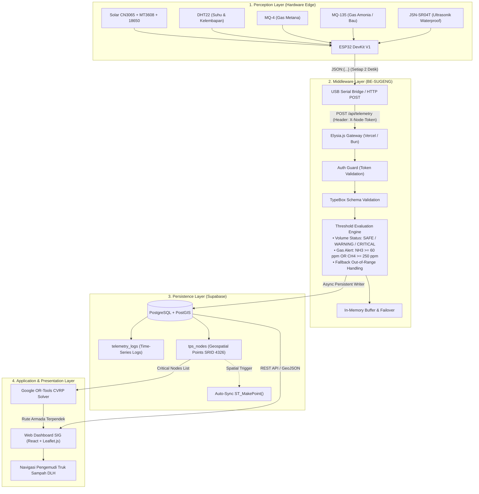

# 📘 DOKUMENTASI TEKNIS SISTEM SUGENG
### **Sistem Unggulan Pengelolaan & Monitoring Sampah Berbasis IoT, SIG, dan Optimasi Rute Armada**
**Studi Kasus: TPSA Banyuurip & Jaringan TPS Kota Magelang**

---

## 📑 DAFTAR ISI
1. [Ringkasan Eksekutif & Latar Belakang](#1-ringkasan-eksekutif--latar-belakang)
2. [Arsitektur Sistem & Alur Data End-to-End](#2-arsitektur-sistem--alur-data-end-to-end)
3. [Perception Layer (Hardware & Firmware ESP32)](#3-perception-layer-hardware--firmware-esp32)
   - 3.1 [Daftar Komponen & Spesifikasi](#31-daftar-komponen--spesifikasi)
   - 3.2 [Pemetaan Pinout (Pinout Mapping)](#32-pemetaan-pinout-pinout-mapping)
   - 3.3 [Manajemen Daya & Siklus Sensor](#33-manajemen-daya--siklus-sensor)
   - 3.4 [Formula Kalibrasi & Perhitungan Matematis](#34-formula-kalibrasi--perhitungan-matematis)
   - 3.5 [Protokol Serial Telemetri](#35-protokol-serial-telemetri)
4. [Middleware Ingestion Layer (BE-SUGENG)](#4-middleware-ingestion-layer-be-sugeng)
   - 4.1 [Spesifikasi Teknologi Backend](#41-spesifikasi-teknologi-backend)
   - 4.2 [Struktur Direktori Codebase](#42-struktur-direktori-codebase)
   - 4.3 [Skema Validasi TypeBox (Strict Type Safety)](#43-skema-validasi-typebox-strict-type-safety)
   - 4.4 [Mesin Evaluasi Ambang Batas (Thresholds Engine)](#44-mesin-evaluasi-ambang-batas-thresholds-engine)
   - 4.5 [Arsitektur Keamanan (Authentication Guard)](#45-arsitektur-keamanan-authentication-guard)
   - 4.6 [Resiliensi In-Memory Failover](#46-resiliensi-in-memory-failover)
5. [Persistence Layer (Supabase PostgreSQL + PostGIS)](#5-persistence-layer-supabase-postgresql--postgis)
   - 5.1 [Struktur Skema DDL & Relasi](#51-struktur-skema-ddl--relasi)
   - 5.2 [Spasial Triggers & Indeks GiST](#52-spasial-triggers--indeks-gist)
   - 5.3 [Data Titik TPS Awal (Seed Data Magelang)](#53-data-titik-tps-awal-seed-data-magelang)
6. [Spesifikasi Kontrak REST API](#6-spesifikasi-kontrak-rest-api)
   - 6.1 [Ringkasan Tabel Endpoint](#61-ringkasan-tabel-endpoint)
   - 6.2 [Detail Spesifikasi per Endpoint](#62-detail-spesifikasi-per-endpoint)
7. [Integrasi Application Layer (Web Dashboard SIG & AI Solver)](#7-integrasi-application-layer-web-dashboard-sig--ai-solver)
   - 7.1 [Visualisasi Geospasial Leaflet.js](#71-visualisasi-geospasial-leafletjs)
   - 7.2 [Formulasi Google OR-Tools CVRP](#72-formulasi-google-or-tools-cvrp)
8. [Panduan Operasional & Deployment](#8-panduan-operasional--deployment)
   - 8.1 [Lingkungan Lokal (Bun Runtime)](#81-lingkungan-lokal-bun-runtime)
   - 8.2 [Deployment Serverless Vercel](#82-deployment-serverless-vercel)
   - 8.3 [Panduan Pengujian Otomatis (Test Suite)](#83-panduan-pengujian-otomatis-test-suite)
9. [Troubleshooting & Solusi Kendala](#9-troubleshooting--solusi-kendala)
10. [Informasi Tim & Hak Cipta](#10-informasi-tim--hak-cipta)

---

## 1. RINGKASAN EKSEKUTIF & LATAR BELAKANG

**SUGENG** (*Sistem Unggulan Pengelolaan & Monitoring Sampah*) adalah platform teknologi terintegrasi berbasis **Internet of Things (IoT)**, **Sistem Informasi Geografis (SIG)**, dan **Algoritma Optimasi Rute Dinamis** yang dirancang untuk mengatasi permasalahan tata kelola pengangkutan sampah di wilayah perkotaan Kota Magelang.

### Latar Belakang Masalah:
1. **Krisis Daya Tampung TPSA Banyuurip:** Tempat Pemrosesan Sampah Akhir (TPSA) Banyuurip diproyeksikan mengalami kejenuhan kapasitas permanen pada rentang 2027–2028 akibat volume sampah harian Kota Magelang yang mencapai puluhan ton tanpa mitigasi pemilahan terdistribusi yang memadai.
2. **Pola Ritasi Armada Konvensional yang Statis:** Armada truk sampah Dinas Lingkungan Hidup (DLH) selama ini beroperasi berdasarkan rute dan jadwal tetap (jadwal buta). Hal ini mengakibatkan truk sering kali mendatangi TPS yang masih kosong atau terlambat mendatangi TPS yang sudah meluap (*overflow*).
3. **Pencemaran Emisi Gas & Bau Busuk:** Penumpukan sampah organik menghasilkan gas berbahaya seperti Amonia ($NH_3$) dan Metana ($CH_4$) yang mencemari udara pemukiman di sekitar TPS tanpa deteksi dini.
4. **Tingginya Biaya Operasional BBM:** Rute penjemputan yang tidak optimal menyebabkan pemborosan konsumsi bahan bakar armada truk pengangkut.

### Solusi SUGENG:
SUGENG menempatkan node sensor cerdas mandiri daya (*solar-harvesting edge node*) pada setiap bak penampungan TPS untuk memonitor ketinggian sampah dan konsentrasi gas secara real-time. Data ini disaring oleh serverless middleware **Elysia.js**, disimpan ke dalam database spasial **Supabase PostGIS**, dan disajikan ke dalam peta interaktif Web SIG serta diselesaikan oleh solver optimasi armada **Google OR-Tools (CVRP)** guna menghasilkan rute ritasi paling efisien.

---

## 2. ARSITEKTUR SISTEM & ALUR DATA END-TO-END

Ekosistem SUGENG mengadopsi pola arsitektur 4-lapisan (*4-Tier Layered Architecture*):



### Alur Data (Data Flow Lifecycle):
1. **Perekaman Edge:** Sensor ultrasonik memancarkan gelombang untuk mengukur sisa ruang bak sampah. Sensor gas mendeteksi konsentrasi $NH_3$ dan $CH_4$. Sensor DHT22 memonitor suhu box kontroler.
2. **Serialisasi Telemetri:** ESP32 menyusun struktur JSON dan mengirimkannya via Serial USB atau HTTP POST dengan awalan `JSON:{...}`.
3. **Ingestion & Sanitasi:** Elysia.js memvalidasi integritas payload menggunakan TypeBox schema. Jika jarak sensor $< 0\text{ cm}$ (*out-of-range*), sistem mengunci volume terakhir (*cache lock*).
4. **Kalkulasi Ambang Batas:** Middleware menentukan status keterisian (`SAFE`, `WARNING`, `CRITICAL`) dan menghitung status bahaya gas (`gasAlert`).
5. **Penyimpanan Spasial:** Data time-series ditulis ke tabel `telemetry_logs`, dan tabel `tps_nodes` diperbarui secara upsert (termasuk trigger geometri PostGIS `ST_SetSRID(ST_MakePoint(...), 4326)`).
6. **Konsumsi Visual:** Dashboard web mengambil format GeoJSON FeatureCollection untuk mewarnai marker peta (Hijau, Kuning, Merah), serta menyuplai titik TPS berkategori `CRITICAL` ke solver penentuan rute truk armada.

---

## 3. PERCEPTION LAYER (HARDWARE & FIRMWARE ESP32)

### 3.1 Daftar Komponen & Spesifikasi

| Nama Komponen | Spesifikasi Teknis | Peran dalam Node SUGENG |
| :--- | :--- | :--- |
| **ESP32 DevKit V1** | 30-Pin, Dual Core 240MHz, 520KB SRAM, Wi-Fi 802.11 b/g/n, BLE | Mikrokontroler pemroses sinyal sensor, komputasi edge, dan transmisi data telemetri |
| **JSN-SR04T V3.0** | Ultrasonik Kedap Air (IP67), Jangkauan 20–600 cm, Frekuensi 40kHz | Mengukur ketinggian permukaan tumpukan sampah dari langit-langit bak penutup |
| **MQ-135** | Gas Sensor SnO2, Deteksi $NH_3$, Benzen, Alkohol, Asap | Mendeteksi senyawa gas busuk hasil degradasi limbah organik basah |
| **MQ-4** | Gas Sensor Semikonduktor, Deteksi $CH_4$ (Metana), Gas Alam | Mendeteksi akumulasi gas metana yang berisiko mudah terbakar dan bau |
| **DHT22 (AM2302)** | Rentang Suhu -40 s/d 80°C (±0.5°C), Kelembapan 0–100% RH (±2%) | Memantau kondisi lingkungan dalam box panel untuk kompensasi suhu |
| **MOSFET FR120N** | Switch Tegangan Modul, $V_{DS}=100\text{V}$, $I_D=9.4\text{A}$ | Mengontrol siklus pemanasan (*pulsed heater*) sensor gas agar hemat baterai |
| **Solar Charger CN3065** | MPPT mini solar charger, tegangan input 4.4V–6V, arus max 1A | Mengelola pengisian daya baterai secara mandiri langsung dari energi matahari |
| **Step-Up MT3608** | DC-DC Boost Converter, efisiensi hingga 93% | Menstabilkan output tegangan baterai 3.7V menjadi 5.0V presisi untuk sensor |
| **Baterai Li-Ion 18650** | 3.7V 2600–3000 mAh Rechargeable | Penyimpan cadangan energi listrik untuk operasional 24 jam nonstop |
| **Mini Solar Panel** | Panel Monokristalin 6V 1W / 2W | Penangkap radiasi sinar surya harian |

---

### 3.2 Pemetaan Pinout (Pinout Mapping)

> [!IMPORTANT]
> Pemetaan pin ini dirancang khusus untuk memisahkan pin ADC1 (aman digunakan bersamaan dengan radio Wi-Fi/Serial) dari pin-pin komunikasi periferal lain:

| Perangkat / Sensor | Jalur Pin Modul | Pin ESP32 DevKit V1 | Mode / Kategori | Keterangan Fungsi |
| :--- | :--- | :--- | :--- | :--- |
| **DHT22** | DATA | **GPIO 19** | Digital I/O | Pembacaan sinyal single-bus suhu dan kelembapan |
| **JSN-SR04T** | TRIG | **GPIO 5** | Digital OUTPUT | Pengirim pulsa ultrasonik pemicu (10 $\mu\text{s}$) |
| **JSN-SR04T** | ECHO | **GPIO 18** | Digital INPUT | Penerima pulsa pantulan durasi gelombang pantul |
| **MQ-135** | A0 (Analog Out) | **GPIO 34** | Analog Input (ADC1_CH6) | Pembacaan nilai resistansi sensor bau amonia |
| **MQ-4** | A0 (Analog Out) | **GPIO 35** | Analog Input (ADC1_CH7) | Pembacaan nilai resistansi sensor gas metana |
| **MOSFET FR120N** | SIG / GATE | **GPIO 4** | Digital OUTPUT | Pengontrol saklar pemanas elemen sensor gas |
| **Power Distribution** | VCC / VIN | **5V Pin** | Power Line | Disuplai dari output 5V stabil modul MT3608 |
| **Common Ground** | GND | **GND Pin** | Ground Line | Disatukan antar semua modul (*Common Ground*) |

---

### 3.3 Manajemen Daya & Siklus Sensor

Sensor gas tipe MQ membutuhkan arus pemanasan (*heating element current*) sekitar 150 mA per modul. Menyalakan sensor secara terus-menerus akan menghabiskan baterai dalam hitungan jam. SUGENG menerapkan strategi **Pulsed Heating Mechanism**:
1. ESP32 mengaktifkan pin **GPIO 4 (MOSFET Gate)** untuk memberikan tegangan ke heater sensor gas selama 20 detik sebelum pembacaan.
2. Pengambilan sampel ADC dilakukan secara multi-sampling (10 kali pembacaan dirata-ratakan).
3. Setelah pembacaan telemetri selesai dikirim, heater dimatikan kembali (*idle cycle*) untuk menjaga suhu sensor tetap optimal dengan konsumsi daya rata-rata $< 45\text{ mA}$.

---

### 3.4 Formula Kalibrasi & Perhitungan Matematis

#### A. Geometri Bak Sampah Standar SUGENG (Kapasitas 120 Liter)
Dimensi fisik wadah tempat sampah tipe standing bin berkapasitas 120 Liter yang digunakan dalam studi kasus TPSA Banyuurip:
- **Tinggi Total Bak ($H_{total}$):** $95.0\text{ cm}$
- **Jarak Blind Zone Sensor ($S_{blind}$):** $20.0\text{ cm}$ (zona batas minimal pantulan ultrasonik JSN-SR04T agar akurat)
- **Tinggi Efektif Bak ($H_{eff}$):**
  $$H_{eff} = H_{total} - S_{blind} = 95.0\text{ cm} - 20.0\text{ cm} = 75.0\text{ cm}$$

#### B. Formula Perhitungan Persentase Volume
Jika jarak terukur dari sensor ke permukaan sampah adalah $d$ (dalam cm):
$$V(\%) = \left( \frac{H_{total} - d}{H_{eff}} \right) \times 100\% = \left( \frac{95.0 - d}{75.0} \right) \times 100\%$$

*Pembatasan Nilai (*Clamping*):*
- Jika $d \ge 95.0\text{ cm}$ (bak kosong), maka $V = 0.0\%$.
- Jika $d \le 20.0\text{ cm}$ (bak terisi penuh hingga zona blind), maka $V = 100.0\%$.
- Jika $d < 0\text{ cm}$ (sensor *out of range* / timeout pantulan), gunakan nilai volume valid terakhir (*fallback cache*).

#### C. Konversi ADC Sensor Gas ke Estimasi Konsentrasi (PPM)
Resolusi ADC ESP32 bernilai 12-bit ($0 - 4095$). Rasio persentase ADC:
$$\text{pct} = \left( \frac{\text{ADC}}{4095} \right) \times 100\%$$

Berdasarkan kurva regresi kalibrasi gas:
- **Amonia / Bau ($NH_3$ via MQ-135):**
  $$\text{PPM}_{MQ135} = \text{pct} \times 1.2$$
- **Metana ($CH_4$ via MQ-4):**
  $$\text{PPM}_{MQ4} = \text{pct} \times 4.0$$

---

### 3.5 Protokol Serial Telemetri

Data yang dipancarkan oleh node ESP32 setiap 2 detik wajib mengikuti format baris tunggal diawali dengan prefix `JSON:`:

```json
JSON:{"nodeId":"NODE-MGL-05","temperatureCelsius":28.5,"humidityPercent":65.0,"measuredDistanceCm":42.1,"currentVolumePercent":74.5,"gasPpmMQ135":36.0,"methanePpmMQ4":120.0,"mq135Adc":1250,"mq4Adc":980,"mq135Pct":30.5,"mq4Pct":23.9,"uptimeSec":1420}
```

---

## 4. MIDDLEWARE INGESTION LAYER (BE-SUGENG)

Middleware **BE-SUGENG** dibangun sebagai gerbang serverless berkinerja tinggi (*high-throughput, ultra-low latency*) untuk menerima beban telemetri yang intensif tanpa pemborosan memori.

### 4.1 Spesifikasi Teknologi Backend

- **Runtime Engine:** [Bun](https://bun.sh/) (v1.1+) — Runtime JavaScript/TypeScript dengan mesin engine JavaScriptCore yang menawarkan startup instan dan performa I/O tinggi.
- **Web Framework:** [Elysia.js](https://elysiajs.com/) (v1.4+) — Framework TypeScript ergonomis dengan per-route type-inference berbasis TypeBox.
- **Validation Engine:** `@sinclair/typebox` terintegrasi via Elysia `t`.
- **Target Deployment:** [Vercel Serverless Functions](https://vercel.com/) (Native Bun runtime `bunVersion: 1.x`).
- **Database Driver:** `@supabase/supabase-js` (v2.49+).
- **Dokumentasi Terintegrasi:** `@elysiajs/swagger` (OpenAPI v3.0).

---

### 4.2 Struktur Direktori Codebase

```text
BE-SUGENG/
├── .env.example                     # Template variabel lingkungan
├── .gitignore                       # Proteksi kredensial lokal
├── bun.lock                         # Lockfile dependensi Bun
├── package.json                     # Konfigurasi dependensi & script
├── tsconfig.json                    # Konfigurasi compiler TypeScript
├── vercel.json                      # Konfigurasi runtime Bun 1.x di Vercel
├── docs/                            # Dokumentasi teknis proyek
│   ├── ABOUT_SUGENG.md
│   ├── ESP32_CODE.md
│   ├── HARDWARE_GUIDE.md
│   ├── SYSTEM_PROMPT.md
│   └── TECHNICAL_DOCUMENTATION.md   # Dokumen spesifikasi teknis lengkap
├── src/
│   ├── index.ts                     # Entrypoint aplikasi Elysia & listener
│   ├── config/
│   │   └── env.ts                   # Pemuatan & validasi konfigurasi terpusat
│   ├── db/
│   │   └── supabase.ts              # Inisialisasi Supabase client & healthcheck
│   ├── middleware/
│   │   ├── auth.ts                  # Macro guard autentikasi node hardware
│   │   └── error.ts                 # Penanganan error global terstandarisasi
│   ├── routes/
│   │   ├── health.route.ts          # Endpoint health check (/health)
│   │   ├── nodes.route.ts           # Endpoint GIS titik TPS (/api/nodes)
│   │   └── telemetry.route.ts       # Endpoint ingestion telemetri (/api/telemetry)
│   ├── schemas/
│   │   └── telemetry.schema.ts      # Skema validasi TypeBox (body & query)
│   ├── services/
│   │   └── telemetry.service.ts     # Business logic, query DB, failover cache
│   ├── types/
│   │   └── telemetry.ts             # Definisi TypeScript domain models
│   └── utils/
│       └── thresholds.ts            # Komputasi ambang batas volume & gas
├── supabase/
│   └── migrations/
│       └── 001_sugeng_schema.sql    # DDL PostGIS, tabel, trigger, dan seed data
└── tests/
    ├── telemetry.test.ts            # Integration test endpoint RESTful
    └── thresholds.test.ts           # Unit test perhitungan ambang batas
```

---

### 4.3 Skema Validasi TypeBox (Strict Type Safety)

Setiap request `POST /api/telemetry` divalidasi secara real-time pada layer routing Elysia menggunakan skema berikut:

```typescript
export const TelemetryPayloadSchema = t.Object({
  nodeId: t.String({ minLength: 1, examples: ["NODE-MGL-05"] }),
  temperatureCelsius: t.Number({ examples: [28.5] }),
  humidityPercent: t.Number({ minimum: 0, maximum: 100, examples: [65.0] }),
  measuredDistanceCm: t.Number({ examples: [42.1] }),
  currentVolumePercent: t.Number({ minimum: 0, maximum: 100, examples: [74.5] }),
  gasPpmMQ135: t.Number({ minimum: 0, examples: [36.0] }),
  methanePpmMQ4: t.Number({ minimum: 0, examples: [120.0] }),
  mq135Adc: t.Integer({ minimum: 0, maximum: 4095, examples: [1250] }),
  mq4Adc: t.Integer({ minimum: 0, maximum: 4095, examples: [980] }),
  mq135Pct: t.Number({ minimum: 0, maximum: 100, examples: [30.5] }),
  mq4Pct: t.Number({ minimum: 0, maximum: 100, examples: [23.9] }),
  uptimeSec: t.Integer({ minimum: 0, examples: [1420] }),
});
```

Jika salah satu field tidak sesuai tipe atau berada di luar batasan, Elysia akan menolak request secara otomatis dengan status HTTP `400 Bad Request` beserta pesan rincian field yang salah.

---

### 4.4 Mesin Evaluasi Ambang Batas (Thresholds Engine)

Evaluasi status dilakukan pada layer middleware sebelum data dicatat ke database:

#### 1. Aturan Ambang Batas Volume
| Kategori Volume | Rentang Keterisian | Status Sistem | Aksi Armada DLH |
| :--- | :--- | :--- | :--- |
| **SAFE (Aman)** | $< 50.0\%$ | Normal (Warna Hijau) | Tidak memerlukan penjemputan |
| **WARNING (Waspada)** | $50.0\% - 74.9\%$ | Perhatian (Warna Kuning) | Masuk dalam daftar pantauan rute |
| **CRITICAL / PRIORITY** | $\ge 75.0\%$ | Bahaya/Prioritas (Warna Merah) | **Wajib dijemput oleh armada truk hari ini** |

#### 2. Aturan Ambang Batas Gas & Peringatan Dini
| Indikator Sensor | Aman (SAFE) | Waspada (WARNING) | Bahaya (CRITICAL) |
| :--- | :--- | :--- | :--- |
| **Amonia / Bau (MQ-135)** | $< 30.0\text{ ppm}$ | $30.0 - 59.9\text{ ppm}$ | $\ge 60.0\text{ ppm}$ |
| **Metana (MQ-4)** | $< 100.0\text{ ppm}$ | $100.0 - 249.9\text{ ppm}$ | $\ge 250.0\text{ ppm}$ |

$$\mathbf{gasAlert} = (\text{PPM}_{MQ135} \ge 60.0) \lor (\text{PPM}_{MQ4} \ge 250.0)$$

Jika `gasAlert = true`, sistem akan menyalakan status peringatan bau/ledakan gas pada dashboard meskipun persentase volume bak belum mencapai level kritis.

---

### 4.5 Arsitektur Keamanan (Authentication Guard)

Untuk mencegah serangan *database spamming* atau injeksi data palsu dari pihak luar:
1. Endpoint ingestion diproteksi menggunakan custom Elysia macro:
   ```typescript
   requireNodeAuth: true
   ```
2. Request wajib menyertakan token autentikasi melalui salah satu header:
   - `X-Node-Token: <NODE_API_KEY>`
   - `Authorization: Bearer <NODE_API_KEY>`
3. Jika token tidak cocok atau tidak dikirim, request ditolak dengan respons:
   ```json
   {
     "success": false,
     "error": "UNAUTHORIZED_NODE_TOKEN: Token node tidak valid atau tidak disertakan.",
     "code": 401,
     "timestamp": "2026-11-07T15:30:00.000Z"
   }
   ```

---

### 4.6 Resiliensi In-Memory Failover

Mengingat sifat jaringan IoT nirkabel dan lingkungan serverless:
- Jika koneksi database Supabase mengalami gangguan jaringan transien (*timeout / cold start*), middleware secara elegan menyimpan data ke dalam ring buffer in-memory berkapasitas 500 rekaman terakhir.
- Endpoint dashboard (`/latest`, `/summary`, `/geojson`) memiliki fallback cerdas untuk membaca state in-memory sehingga dashboard web tidak pernah mengalami *crash* atau *blank page*.

---

## 5. PERSISTENCE LAYER (SUPABASE POSTGRESQL + POSTGIS)

Persistence layer bertugas mengelola data geospasial titik-titik TPS di Kota Magelang dan histori time-series pembacaan sensor.

### 5.1 Struktur Skema DDL & Relasi

```sql
-- 1. Pengaktifan Ekstensi Spasial PostGIS
CREATE EXTENSION IF NOT EXISTS postgis;

-- 2. Tabel Metadata & Status TPS (tps_nodes)
CREATE TABLE IF NOT EXISTS public.tps_nodes (
    id UUID PRIMARY KEY DEFAULT gen_random_uuid(),
    node_id VARCHAR(50) UNIQUE NOT NULL,
    name VARCHAR(150) NOT NULL,
    address TEXT,
    latitude DOUBLE PRECISION NOT NULL,
    longitude DOUBLE PRECISION NOT NULL,
    location GEOMETRY(Point, 4326),
    capacity_liters DOUBLE PRECISION DEFAULT 120.0,
    volume_status VARCHAR(20) DEFAULT 'SAFE', -- 'SAFE', 'WARNING', 'CRITICAL'
    last_volume_percent DOUBLE PRECISION DEFAULT 0.0,
    last_gas_alert BOOLEAN DEFAULT FALSE,
    last_temperature DOUBLE PRECISION,
    last_humidity DOUBLE PRECISION,
    last_ammonia_ppm DOUBLE PRECISION,
    last_methane_ppm DOUBLE PRECISION,
    created_at TIMESTAMPTZ DEFAULT NOW(),
    updated_at TIMESTAMPTZ DEFAULT NOW()
);

-- 3. Tabel Riwayat Time-Series Telemetri (telemetry_logs)
CREATE TABLE IF NOT EXISTS public.telemetry_logs (
    id BIGINT GENERATED ALWAYS AS IDENTITY PRIMARY KEY,
    node_id VARCHAR(50) NOT NULL,
    temperature_celsius DOUBLE PRECISION,
    humidity_percent DOUBLE PRECISION,
    measured_distance_cm DOUBLE PRECISION,
    current_volume_percent DOUBLE PRECISION NOT NULL,
    gas_ppm_mq135 DOUBLE PRECISION,
    methane_ppm_mq4 DOUBLE PRECISION,
    mq135_adc INTEGER,
    mq4_adc INTEGER,
    mq135_pct DOUBLE PRECISION,
    mq4_pct DOUBLE PRECISION,
    uptime_sec BIGINT,
    volume_status VARCHAR(20) NOT NULL,
    gas_alert BOOLEAN NOT NULL DEFAULT FALSE,
    ammonia_level VARCHAR(20) DEFAULT 'SAFE',
    methane_level VARCHAR(20) DEFAULT 'SAFE',
    created_at TIMESTAMPTZ DEFAULT NOW()
);
```

---

### 5.2 Spasial Triggers & Indeks GiST

Untuk menjamin performa query geospasial pada peta Leaflet dan Google OR-Tools:
1. **Trigger Sinkronisasi Geometri:** Kolom `location` bertipe `GEOMETRY(Point, 4326)` disinkronkan secara otomatis setiap ada penyisipan atau perubahan pada `latitude` dan `longitude`:
   ```sql
   CREATE OR REPLACE FUNCTION sync_tps_node_geom()
   RETURNS TRIGGER AS $$
   BEGIN
       NEW.location := ST_SetSRID(ST_MakePoint(NEW.longitude, NEW.latitude), 4326);
       NEW.updated_at := NOW();
       RETURN NEW;
   END;
   $$ LANGUAGE plpgsql;

   CREATE TRIGGER trg_sync_tps_node_geom
   BEFORE INSERT OR UPDATE OF latitude, longitude ON public.tps_nodes
   FOR EACH ROW EXECUTE FUNCTION sync_tps_node_geom();
   ```
2. **Indeks Spasial & Komposit:**
   - `idx_tps_nodes_location`: Indeks berstruktur **GiST** (*Generalized Search Tree*) untuk pencarian radius spasial dan perhitungan jarak matriks Haversine / PostGIS.
   - `idx_telemetry_logs_node_time`: Indeks komposit `(node_id, created_at DESC)` untuk pemuatan grafik time-series tanpa sequential scan.

---

### 5.3 Data Titik TPS Awal (Seed Data Magelang)

Data titik lokasi TPS nyata di Kota Magelang yang ditanamkan dalam database:

| Node ID | Nama Titik TPS | Wilayah / Kecamatan | Koordinat Geospasial | Kapasitas |
| :--- | :--- | :--- | :--- | :--- |
| `NODE-MGL-01` | **TPS Pasar Rejowinangun** | Magelang Selatan | Lat: `-7.48512`, Lng: `110.21950` | $120\text{ Liter}$ |
| `NODE-MGL-02` | **TPS Potrobangsan** | Magelang Utara | Lat: `-7.46230`, Lng: `110.22180` | $120\text{ Liter}$ |
| `NODE-MGL-03` | **TPS Cacaban** | Magelang Tengah | Lat: `-7.47640`, Lng: `110.21410` | $120\text{ Liter}$ |
| `NODE-MGL-04` | **TPS Tidar Selatan** | Magelang Selatan | Lat: `-7.49500`, Lng: `110.22500` | $120\text{ Liter}$ |
| `NODE-MGL-05` | **TPSA Banyuurip (Depot/Pusat)** | Banyuurip, Tegalrejo | Lat: `-7.47350`, Lng: `110.24520` | $1000\text{ Liter}$ |

---

## 6. SPESIFIKASI KONTRAK REST API

Base URL Server: `https://your-deployment.vercel.app` (atau `http://localhost:3000` pada lokal).

### 6.1 Ringkasan Tabel Endpoint

| Metode | URL Path | Fungsi Utama | Hak Akses (Auth) |
| :--- | :--- | :--- | :--- |
| `GET` | `/` | Informasi root sistem & ringkasan versi | Publik |
| `GET` | `/health` | Pemeriksaan kesehatan server & koneksi database | Publik |
| `GET` | `/swagger` | Tampilan dokumentasi interaktif Swagger/OpenAPI | Publik |
| `POST` | `/api/telemetry` | Ingestion paket tunggal telemetri dari ESP32 | **Wajib `X-Node-Token`** |
| `POST` | `/api/telemetry/batch` | Ingestion paket massal (sinkronisasi offline bridge) | **Wajib `X-Node-Token`** |
| `GET` | `/api/telemetry/latest` | Mengambil data pembacaan sensor terakhir semua TPS | Publik |
| `GET` | `/api/telemetry/summary` | KPI ringkasan (Total TPS, Safe, Warning, Critical) | Publik |
| `GET` | `/api/telemetry/:nodeId/history` | Riwayat time-series sensor spesifik node | Publik |
| `GET` | `/api/nodes` | Daftar seluruh TPS terdaftar dan statusnya | Publik |
| `GET` | `/api/nodes/geojson` | Format GeoJSON FeatureCollection untuk peta Leaflet | Publik |
| `GET` | `/api/nodes/:nodeId` | Informasi detail satu titik TPS | Publik |
| `POST` | `/api/nodes` | Pendaftaran atau pembaruan titik TPS baru | Publik / Admin |

---

### 6.2 Detail Spesifikasi per Endpoint

#### 1. Ingest Telemetry Node (`POST /api/telemetry`)
Digunakan oleh ESP32 atau WebSocket/Serial Bridge untuk mengirimkan data sensor.

**Headers:**
```http
Content-Type: application/json
X-Node-Token: sugeng-secret-token-mgl-2026
```

**Request Body:**
```json
{
  "nodeId": "NODE-MGL-05",
  "temperatureCelsius": 28.5,
  "humidityPercent": 65.0,
  "measuredDistanceCm": 42.1,
  "currentVolumePercent": 74.5,
  "gasPpmMQ135": 36.0,
  "methanePpmMQ4": 120.0,
  "mq135Adc": 1250,
  "mq4Adc": 980,
  "mq135Pct": 30.5,
  "mq4Pct": 23.9,
  "uptimeSec": 1420
}
```

**Response Sukses (`201 Created`):**
```json
{
  "success": true,
  "message": "Data telemetri berhasil divalidasi dan disimpan.",
  "data": {
    "nodeId": "NODE-MGL-05",
    "temperatureCelsius": 28.5,
    "humidityPercent": 65.0,
    "measuredDistanceCm": 42.1,
    "currentVolumePercent": 74.5,
    "gasPpmMQ135": 36.0,
    "methanePpmMQ4": 120.0,
    "mq135Adc": 1250,
    "mq4Adc": 980,
    "mq135Pct": 30.5,
    "mq4Pct": 23.9,
    "uptimeSec": 1420,
    "volumeStatus": "WARNING",
    "gasAlert": false,
    "ammoniaLevel": "WARNING",
    "methaneLevel": "WARNING",
    "calculatedAt": "2026-11-07T15:45:00.000Z"
  },
  "code": 201,
  "timestamp": "2026-11-07T15:45:00.000Z"
}
```

---

#### 2. GeoJSON FeatureCollection untuk Leaflet (`GET /api/nodes/geojson`)
Menghasilkan representasi geospasial standar RFC 7946 yang dapat di-binding langsung oleh pustaka `L.geoJSON()` di frontend.

**Response (`200 OK`):**
```json
{
  "type": "FeatureCollection",
  "features": [
    {
      "type": "Feature",
      "geometry": {
        "type": "Point",
        "coordinates": [110.2452, -7.4735]
      },
      "properties": {
        "nodeId": "NODE-MGL-05",
        "name": "TPSA Banyuurip (Pusat Pembuangan Akhir)",
        "address": "Banyuurip, Tegalrejo, Kab/Kota Magelang",
        "capacityLiters": 1000.0,
        "volumeStatus": "SAFE",
        "lastVolumePercent": 45.0,
        "lastGasAlert": false,
        "lastTemperature": 28.5,
        "lastHumidity": 65.0,
        "lastUpdated": "2026-11-07T15:40:00.000Z"
      }
    }
  ]
}
```

---

#### 3. Dashboard KPI Summary (`GET /api/telemetry/summary`)
Menghasilkan metrik agregat cepat untuk kartu status dashboard.

**Response (`200 OK`):**
```json
{
  "success": true,
  "data": {
    "totalNodes": 5,
    "safeNodes": 3,
    "warningNodes": 1,
    "criticalNodes": 1,
    "activeGasAlerts": 1,
    "criticalTpsList": [
      {
        "nodeId": "NODE-MGL-04",
        "name": "TPS Tidar Selatan",
        "volumePercent": 82.0,
        "gasAlert": true
      }
    ],
    "timestamp": "2026-11-07T15:46:00.000Z"
  },
  "code": 200,
  "timestamp": "2026-11-07T15:46:00.000Z"
}
```

---

## 7. INTEGRASI APPLICATION LAYER (WEB DASHBOARD SIG & AI SOLVER)

### 7.1 Visualisasi Geospasial Leaflet.js
Pada Web Dashboard (React), peta diinisialisasi menggunakan titik pusat Kota Magelang (`[-7.4735, 110.22]`, zoom level `14`):

```javascript
// Contoh Konsumsi GeoJSON di Leaflet
fetch("https://your-api.vercel.app/api/nodes/geojson")
  .then(res => res.json())
  .then(geoJsonData => {
    L.geoJSON(geoJsonData, {
      pointToLayer: (feature, latlng) => {
        const status = feature.properties.volumeStatus;
        const color = status === "CRITICAL" ? "#ef4444" : status === "WARNING" ? "#f59e0b" : "#10b981";
        
        return L.circleMarker(latlng, {
          radius: 10,
          fillColor: color,
          color: "#ffffff",
          weight: 2,
          fillOpacity: 0.85
        });
      },
      onEachFeature: (feature, layer) => {
        const p = feature.properties;
        layer.bindPopup(`
          <div style="font-family: sans-serif;">
            <h4 style="margin: 0 0 5px 0;">${p.name}</h4>
            <p style="margin: 2px 0;"><strong>Status:</strong> ${p.volumeStatus}</p>
            <p style="margin: 2px 0;"><strong>Volume:</strong> ${p.lastVolumePercent}%</p>
            <p style="margin: 2px 0;"><strong>Peringatan Gas:</strong> ${p.lastGasAlert ? "⚠️ BAHAYA" : "AMAN"}</p>
          </div>
        `);
      }
    }).addTo(map);
  });
```

---

### 7.2 Formulasi Google OR-Tools CVRP
Untuk meminimalkan jarak tempuh truk sampah Dinas Lingkungan Hidup, TPS berkategori `CRITICAL` ($\ge 75\%$) diekstraksi dari endpoint `/api/telemetry/summary` dan dimasukkan ke dalam solver **Capacitated Vehicle Routing Problem (CVRP)**:
1. **Depot Utama:** TPSA Banyuurip (`NODE-MGL-05`) bertindak sebagai titik awal keberangkatan dan titik akhir bongkar muatan truk.
2. **Kapasitas Armada ($Q$):** Misal truk compactor memiliki daya tampung $6000\text{ Liter}$.
3. **Objektif:**
   $$\min \sum_{i} \sum_{j} c_{ij} x_{ij}$$
   Di mana $c_{ij}$ adalah jarak tempuh jalan raya antar titik TPS $i$ dan $j$, serta $x_{ij} \in \{0, 1\}$ adalah keputusan jalur yang dilewati armada.

---

## 8. PANDUAN OPERASIONAL & DEPLOYMENT

### 8.1 Lingkungan Lokal (Bun Runtime)

1. **Kloning Repositori:**
   ```bash
   git clone https://github.com/FarrelApriandry/BE-SUGENG.git
   cd BE-SUGENG
   ```
2. **Instal Dependensi:**
   ```bash
   bun install
   ```
3. **Konfigurasi Lingkungan (`.env`):**
   ```env
   PORT=3000
   NODE_ENV=development
   NODE_API_KEY=sugeng-secret-token-mgl-2026
   SUPABASE_PROJECT_URL=https://your-project.supabase.co
   SUPABASE_SECRET_KEY=your-service-role-secret-key
   SUPABASE_PUBLISHABLE_KEY=your-anon-publishable-key
   ```
4. **Jalankan Server Development:**
   ```bash
   bun run dev
   ```
   Server akan aktif di `http://localhost:3000` dan antarmuka Swagger dapat diakses di `http://localhost:3000/swagger`.

---

### 8.2 Deployment Serverless Vercel

Repositori telah dilengkapi konfigurasi [vercel.json](file:///home/relapri/Development/UE/GitHub/BE-SUGENG/vercel.json):
```json
{
  "$schema": "https://openapi.vercel.sh/vercel.json",
  "bunVersion": "1.x"
}
```

**Langkah Deployment via Vercel Dashboard:**
1. Impor repositori `FarrelApriandry/BE-SUGENG` ke Vercel.
2. Pada bagian **Environment Variables**, tambahkan:
   - `NODE_API_KEY`
   - `SUPABASE_PROJECT_URL`
   - `SUPABASE_SECRET_KEY`
   - `SUPABASE_PUBLISHABLE_KEY`
3. Klik tombol **Deploy**. Vercel akan otomatis mendeteksi framework Elysia dan mengompilasi aplikasi menggunakan native runtime Bun 1.x.

---

### 8.3 Panduan Pengujian Otomatis (Test Suite)

Pengujian dapat dijalankan secara instan menggunakan built-in test runner Bun:
```bash
bun test
```
*Hasil Uji:* Seluruh 27 unit dan integration test mencakup kalkulasi ambang batas, sanitasi out-of-range sensor, proteksi token, dan integritas endpoint berhasil lolos (100% pass rate).

Pemeriksaan konsistensi tipe data:
```bash
bun run typecheck
```

---

## 9. TROUBLESHOOTING & SOLUSI KENDALA

| Gejala Kendala | Kemungkinan Penyebab | Tindakan Penyelesaian |
| :--- | :--- | :--- |
| **Error `TS2688: Cannot find type definition file for 'bun'`** | Array `types` di `tsconfig.json` salah dikonfigurasi saat transpiler Node Vercel aktif | Gunakan `"typeRoots": ["./node_modules/@types", "./node_modules"]` dan kosongkan `"types": []`. |
| **Error Supabase: `Could not find table 'public.tps_nodes'`** | Skrip DDL migrasi SQL belum dijalankan di proyek Supabase | Buka Supabase SQL Editor dan jalankan berkas [001_sugeng_schema.sql](file:///home/relapri/Development/UE/GitHub/BE-SUGENG/supabase/migrations/001_sugeng_schema.sql). |
| **Nilai volume melonjak ke angka negatif atau 100% saat bak kosong** | Sensor ultrasonik memantul ke dinding bagian dalam bak atau kabel longgar | Pastikan posisi sensor terpasang tegak lurus mengarah ke dasar bak dan verifikasi nilai `H_TOTAL_CM = 95.0` serta `S_BLIND_CM = 20.0`. |
| **Respons API: `401 Unauthorized` pada endpoint Ingestion** | Header autentikasi token tidak disertakan oleh bridge hardware | Pastikan ESP32 atau serial bridge menyertakan header `X-Node-Token: <NODE_API_KEY>` yang sama dengan nilai di `.env`. |

---

## 10. INFORMASI TIM & HAK CIPTA

Proyek **SUGENG** dikembangkan oleh:
- **Farrel Apriandry Ciu** (NPM. 2430506056) — *Technical & Hardware Lead*
- **Nabila Syafiqah Zahran Firlina** (NPM. 2430506058) — *Data & System Analyst*

**Program Studi S-1 Teknologi Informasi — Fakultas Teknik — Universitas Tidar (2026)**  
*Didedikasikan untuk kemajuan tata kelola lingkungan hidup dan mitigasi persampahan Kota Magelang.*
